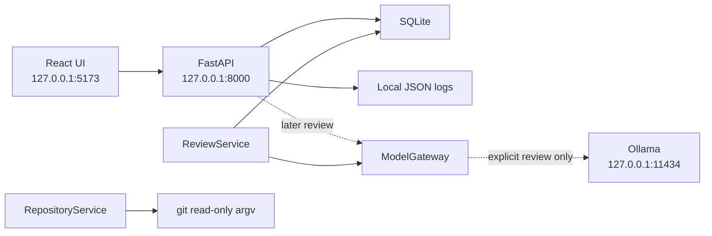

# Architecture

DevPilot is a local-first review assistant. Phase 0 is the shell: configuration, storage, and the UI. It does not run a review and it does not call Ollama.

## Services

| Service | Responsibility in Phase 0 |
| --- | --- |
| `RepositoryService` | Validates a read-only `git` argument list. It does not execute it. |
| `ReviewService` | Depends on the `InferenceClient` protocol, not on a concrete model. It does not start a review. |
| `ModelGateway` | Builds a local Ollama client with proxy use and redirects disabled. Construction and `open_client()` do not send a request. |
| `QualityCheckService` | Reads stored quality-check rows. |
| `ReleaseReportService` | Reads stored release-report rows. |
| `Persistence` helpers | Ping SQLite and list stored rows. Nothing is seeded. |

A later model is selected by changing `DEVPILOT_MODEL` or the settings page. `ReviewService` does not import Ollama.

## Process boundaries

- The API binds only to `127.0.0.1`, `localhost`, or `::1`. `0.0.0.0` is rejected.
- CORS allows the configured loopback UI origin and its `localhost` / `127.0.0.1` alias. There is no `*` origin.
- The Ollama URL must resolve only to loopback addresses. Hosted host names are rejected before DNS.
- Hosted model names are rejected. A model at 20B parameters or larger requires `large_model_confirmed=true`.
- The database URL must be a SQLite file. Remote databases are rejected.
- Interactive API docs are off so the browser does not load a documentation CDN.
- Logs are JSON on disk, mode `0600`. Secret-shaped text, prompts, diffs, and model responses are redacted or dropped.

## What Phase 0 does not do

- It does not start a review, chunk a diff, or score findings.
- It does not call Ollama, pull a model, or fall back to a hosted model.
- It does not execute git, shell, patches, or text returned by a model.
- It does not commit, push, merge, reset, clean, or switch branches.
- It does not insert sample findings.
