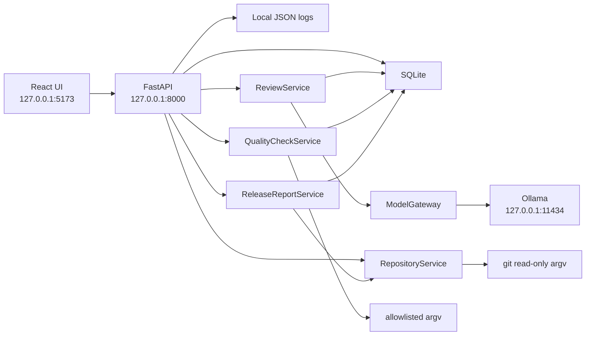

# Architecture

DevPilot is a local-first review assistant. Phase 2 reviews a selected diff through the local Ollama HTTP API. Phase 3 runs confirmed PHP and Magento commands. Phase 4 combines those results with human decisions into a release assessment. Phase 5 hardens the local boundaries and checks the workflow without downloading a model. It does not call a hosted model, and it does not treat model output as approval to ship. The application is not declared production-ready. The limits are in [docs/hardening.md](hardening.md).

## Services

| Service | Responsibility |
| --- | --- |
| `RepositoryService` | Registers a local work tree, inspects branches and status, and reads diffs. Every `git` invocation is an allowlisted argument list pinned to that work tree. `prepare()` still validates an argument list without executing it. |
| `ReviewService` | Builds a manifest, chunks the selected diff, calls `InferenceClient`, checks every finding against that diff, and stores the summary. |
| `ModelGateway` | Sends `POST /api/chat` to the configured loopback Ollama origin. Construction and `open_client()` do not send a request. Redirects and proxy environment variables stay off. |
| `QualityCheckService` | Detects project tools, stores an allowlisted argument list, and runs it after an explicit confirmation. |
| `ReleaseReportService` | Builds a readiness assessment from a stored review, quality-check rows, and human decisions. It reads Git to record the current commit. It does not call Ollama and it does not run a quality command. |
| `Persistence` helpers | Ping SQLite and list stored rows. Nothing is seeded. |

A later model is selected by changing `DEVPILOT_MODEL` or the settings page. `ReviewService` does not import Ollama.

## Process boundaries

- The API binds only to `127.0.0.1`, `localhost`, or `::1`. `0.0.0.0` is rejected.
- CORS allows the configured loopback UI origin and its `localhost` / `127.0.0.1` alias. There is no `*` origin.
- The Ollama URL must resolve only to loopback addresses. Hosted host names are rejected before DNS.
- Hosted model names are rejected. A model at 20B parameters or larger requires `large_model_confirmed=true`.
- The database URL must be a SQLite file. Remote databases are rejected.
- Interactive API docs are off so the browser does not load a documentation CDN.
- Logs are JSON on disk, mode `0600`. Secret-shaped text, prompts, diffs, and model responses are redacted or dropped.
- Git is resolved to an absolute `git` binary outside the registered work tree. A timeout or an oversized read kills that process group.
- When the stored Alembic revision is not the current head, startup copies `data/devpilot.db` to `data/devpilot.db.bak` (mode `0600`) before upgrading. A database that is already at head is not copied again.

## What this build does not do

- It does not pull a model, search the web, or fall back to a hosted model.
- It does not let the model edit source or execute tools.
- It does not present an AI suggestion as a deterministic test failure.
- It does not run a quality command during registration or during a review. A check runs only after that command is saved and the user confirms that execution.
- It does not install Composer packages, change project configuration, or run destructive and deployment commands.
- It does not execute shell text, patches, or text returned by a model or by repository files.
- It does not commit, push, merge, reset, clean, checkout, or switch branches.
- It does not treat a release assessment as approval. The stored report status stays `draft`. `ready_for_human_approval` means a person can decide.
- It does not insert sample findings.
- It does not read `.env`, `app/etc/env.php`, private keys, or other credential-shaped files, and it does not load generated directories into the diff viewer.
- It does not authenticate callers. Any process on this machine that can open the loopback port can call the API.
- It does not treat a repository comment as trusted. A finding is kept only when its quote appears in the diff that was sent. A hostile comment that the model quotes can still become a suggestion a person must judge.
